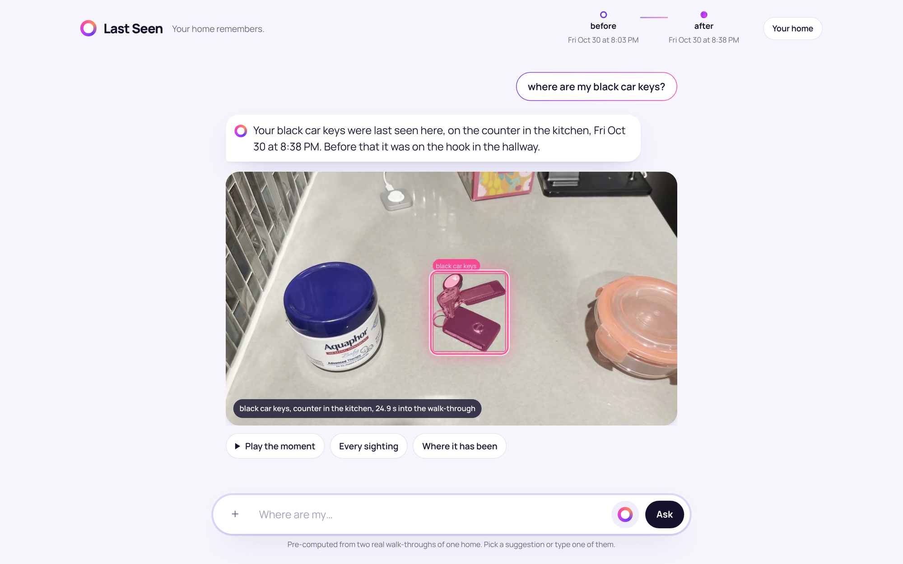
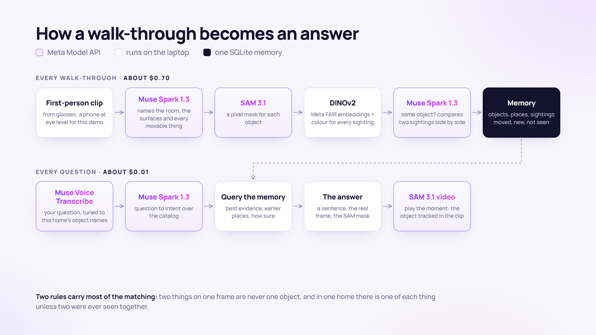

# Last Seen

Object-permanence memory for your home, built on the Meta Model API for smart glasses.

Your glasses already see where you put things down. Last Seen turns that first-person video into a
memory of your home, so later you can just ask:

> where did I leave my passport?  ·  what moved off the counter since this morning?

The answer is a sentence, the frame where the thing was last seen with its SAM mask, where it was
before that, and a short tracked clip of the moment. Nothing is labelled by hand. Muse Spark finds and
names every movable thing, SAM 3.1 cuts each one out, DINOv2 embeddings and a Spark side-by-side check
decide which sightings are the same physical object, and a small state machine marks each one
*stationary*, *moved*, *new* or *not seen*.

The demo footage was filmed on a phone held at eye level as a stand-in for glasses. The pipeline
accepts any first-person clip.

**Video:** https://youtu.be/gwyIGE2Dwgk · **Live demo** (real footage, pre-computed, no key needed):
https://kpulagam.github.io/last-seen/demo/

Built for the Meta Global AI Developer Hackathon 2026, indie track.



## Using it

Ask out loud (tap the ring; it stops listening when you stop talking) or type. The answer arrives as a
sentence, for example *"Your black car keys were last seen here, on the counter in the kitchen, Fri Oct
30 at 8:38 PM. Before that it was on the hook in the hallway."* Under it, the frame comes into focus and
the mask lights up on the object. Three buttons go further: *Play the moment* plays the tracked clip,
*Every sighting* shows the frame from each walk-through, and *Where it has been* draws the trail. When
you start typing the next question the pictures fold away and the sentences stay. Clicking a
walk-through in the header asks what it changed, and *Your home* shows every room, surface and thing
the memory holds.

## Meta models in the pipeline

| Model | Used for | Calls per 60 s clip |
|---|---|---|
| **Muse Spark 1.3** (vision, structured JSON, `reasoning_effort=low`) | keyframe grounding: room, surfaces, every movable object with a 0–1000 box · one attribute record per object cluster (canonical name, category, colours, brand, marks) · side-by-side "same object?" judgement with a single-home prior · question → intent JSON | ~30 + ~40 + 5–20 + 1 per question |
| **SAM 3.1** (image box prompts, ≤16 per request) | pixel masks and tight boxes for every grounded object, giving clean crops for embedding and the answer overlay | ~30 |
| **SAM 3.1** (video box prompt, 150-frame window) | "Play the moment": the object's mask tracked over the seconds around the answer | 1 per answer, on demand |
| **Muse Voice Transcribe** | the spoken question, with the home's object names passed as keywords | 1 per spoken question |
| **DINOv2-small** (Meta FAIR, Apache-2.0; DINOv3 ViT-S/16 wired in behind its gated login) | three embeddings per sighting on Apple MPS (object, mask-pooled patches, background ring), 13 ms each | local |

Every API call is logged under `runs/<run>/api/` (request without media, response, usage, timing) and
cached under `data/api_cache/`, so re-runs cost nothing.

## Setup (macOS on Apple Silicon; Linux with CUDA or CPU also works)

```bash
git clone https://github.com/kpulagam/last-seen && cd last-seen
python3 -m venv .venv && source .venv/bin/activate
pip install -r requirements.txt
brew install ffmpeg                          # if `ffmpeg -version` fails
echo "MODEL_API_KEY=..." > .env              # key from dev.meta.ai; never commit it
hf auth login                                # optional: unlocks DINOv3 (gated). Thresholds were tuned on DINOv2; re-tune with scripts/replay.py
```

## Run

```bash
python scripts/smoke_test.py                 # first contact: 8 API calls on a synthetic image and video
python scripts/ingest.py clips/monday-am.mov --session monday-am --stride 1
python scripts/ingest.py clips/monday-pm.mov --session monday-pm --stride 1   # 1 s keyframes; walking video is often blurry
python scripts/ask.py "where is my massage gun?"
python scripts/ask.py "what moved since this morning?"
python scripts/ask.py --window "where is my charger?"   # also builds the tracked clip
uvicorn app.server:app --port 8008           # web app at http://localhost:8008
```

## Capturing good clips

The memory only knows what the camera saw. On glasses most of this happens on its own; with a phone,
hold it at eye level and:

* **Look at each surface for a second or two.** Keyframes are taken every second (`--stride 1`), so a
  short pause gives two sharp frames of everything on it. Quick glances become blurry crops, which are
  kept but never trusted on their own.
* **Take a similar route each time.** From a similar angle the same object scores 0.8 to 0.97 on
  embedding similarity. Scissors lying flat versus standing in a cup score 0.2, and only Spark's
  side-by-side check can link those.
* **Keep the lighting similar.** Colour names feed the matching, and a dim room turns grey metal black.
* **Set things down before the camera passes.** An object in your hand counts as its own place.
* **What works best:** hand-sized or larger things with a distinct shape or colour (keys with a fob,
  wallet, watch, remote, bottle, headphones). What struggles: cables, paper, socks, anything that looks
  like its neighbours. Two identical items are one object to the system.
* **Name sessions plainly** (`--session monday-am`, `--session after-dinner`). The names appear in
  answers ("what did the after-dinner walk-through change?").

The first run in a new home may need a few taps. Look-alikes the system could not settle go to *Needs
your call* with both crops and Spark's reason, and anything glimpsed only once is reported as *less
sure*. If a pair is settled wrongly, `scripts/explain.py <sighting_id>` shows which check decided, and
`scripts/replay.py` re-runs re-identification on stored embeddings without new API calls.

Tuning without spending API calls:

```bash
python scripts/replay.py --requality --retrack   # re-run clustering, re-ID, dedupe and states on stored embeddings
REID_T_MATCH=0.75 python scripts/replay.py       # any threshold in lastseen/reid.py is an env var
python scripts/explain.py 143                    # why a sighting matched or didn't: candidates, scores, checks
python scripts/sheet.py objects                  # contact sheet: one row per object, crops per session
python scripts/pair_test.py --a 6 --b 152 --object 8 --session 2   # one Spark side-by-side call, as the pipeline would ask it
python scripts/export_static.py docs/demo        # the app as a static site with pre-computed answers (served at /demo and by GitHub Pages)
```

## Pipeline



```
clip ─ffmpeg─▶ 1280px CFR keyframes (2 s stride + scene cuts, sharpest of ±3 frames)
keyframe ─Spark grounding─▶ room, surfaces, movable objects (stickers, fragments and blurry things filtered)
boxes ─SAM 3.1 image prompts─▶ masks ─▶ crops: object (background blanked), background ring, full
crops ─DINOv2─▶ e_obj, e_patch, e_ring  +  mean CIELAB of the object's pixels  +  crop quality
quality = contrast-normalised sharpness × size; blurry or tiny crops are kept but never drive a match
tracklets (same-name boxes across keyframes) ─▶ clusters (embedding ≥ 0.65, or ≥ 0.45 with the same noun; never co-seen)
cluster ─Spark attributes─▶ canonical name, category, colours, brand, marks
re-ID vs the object table: co-occurrence veto → colour veto → thresholds → Spark side-by-side → ask the user
dedupe: looks alike · same name never co-seen · "not seen at P" + "new at P" ─▶ Spark decides
objects + places (room, surface) ─▶ per-session modal place ─▶ stationary / moved / new / not seen / possibly hidden
question ─Spark intent over the catalog─▶ SQL ─▶ answer sentence + evidence (+ "before that it was on …", + confidence tiers)
answer ─SAM 3.1 video, 150 frames both directions─▶ tracked overlay clip
```

Two rules carry most of the matching:

* **Co-occurrence.** Two sightings on the same keyframe are always different objects.
* **Single-home prior.** A home usually has one of each thing, so two sightings of the same kind and
  colour that were never seen together are treated as one object unless a side-by-side look finds a
  real difference. Spark is told that blur, viewpoint and lighting don't count as differences.

Keyframes plus short tracking windows, instead of tracking the whole clip: SAM 3.1 video is billed per
frame with a 50-frame minimum, and track ids don't survive an object leaving the frame and coming back,
which happens constantly as you walk around. Keyframe sightings are the identity record; video tracking
is used only for the answer clip.

## What made matching work

Measured on real footage of one apartment:

* Same object across two clips (DINOv2, 0.6 × object + 0.4 × patch): massage gun 0.91, jacket 0.97,
  laptop 0.82, steel bottle 0.88, scissors 0.64. Different large objects: 0.54 or lower. Same kind,
  different object (soap bottle vs steel bottle): 0.39 or lower.
* DINOv2 is nearly colour-blind: a peach soap bottle and a steel bottle embed alike. The mean CIELAB
  colour of the masked pixels separates them; an a/b distance over 22 rules out a match.
* Thresholds alone produced 147 objects for about 40 real ones. Four fixes brought that down: a tighter
  rule for linking boxes across keyframes, a larger output budget for Spark (`max_tokens ≥ 4000` with
  `reasoning_effort=low`), no automatic matches from blurry crops, and comparing colour names as sets,
  since the same jacket gets called "blue" one time and "dark gray" the next.
* Absence counts only for a spot that was filmed again. A surface where any object was seen in a
  walk-through counts as looked at, even if Spark never listed it as a surface (a wall of hooks, for
  example).
* A partial mask is worse than none. When SAM's mask covers less than 35% of its box, the plain crop is
  used for naming and for side-by-side checks.
* Context helps the side-by-side check and can also mislead it. Telling Spark "A was last seen on the
  hook, the hook was filmed again and A wasn't there, B appeared on the counter" correctly linked the
  car keys, and wrongly linked a white cap to a grey one. So the context is added only when the two
  already look alike (similarity 0.5 or more, compatible colours), Spark's verdicts are stored, a
  confident "different" is never asked again, and "not seen" claims that rest only on blurry glimpses
  are marked *less sure*.

On the demo apartment (two walk-throughs 35 minutes apart, five things moved on purpose): 182
sightings, 30 objects, all five moves found with high confidence, and nothing that stayed put reported
as moved.

## Honesty rules in the answers

* A move needs two or more sightings on each side; otherwise it is reported as *less sure*.
* "Not seen" means the place was filmed again and the object wasn't found there. It never means "gone".
* When two objects match a question, the one seen more often wins and the other is offered as an option.
* Unsettled same-object decisions go to *Needs your call* with both crops and Spark's reason.

## Cost (60 s clip at 30 fps, about 30 keyframes and 40 objects)

| Call | Count | ≈ Cost |
|---|---|---|
| Spark grounding (one image each) | 30 | $0.35 |
| SAM image box prompts | 30 | $0.08 |
| Spark attributes (per cluster) | ~40 | $0.15 |
| Spark side-by-side checks | 5–20 | ≤ $0.10 |
| SAM video window (150 frames) | per answer | $0.03 |

About $0.70 per clip and about a cent per question; re-runs hit the cache.

## Next

* **Clips straight from Meta glasses**, then a continuous mode where there is no walk-through to film,
  only living in the house. Capture stays event-based (a short clip when you come through the door) to
  keep the cost at cents: grounding one frame a second, all day, would be about $40 an hour.
* **Habits.** The logic is in `lastseen/habits.py` and tested in `tests/test_habits.py`. From the third
  walk-through on, an object's usual place is where a strict majority of walk-throughs saw it, and the
  app flags what is out of place ("black car keys: now on the kitchen counter; in both earlier
  walk-throughs they were on the hallway hook") and what is back. On glasses this becomes a nudge when
  you set the keys down somewhere new.
* A shared memory for the whole household.
* Learning each home's names for its surfaces, so a place stops drifting between "island" and "counter".
* A labelled evaluation set for re-ID precision and recall.

## Layout

```
lastseen/   meta_client · video · sam_parse · rle · db · prompts · ingest · reid · state · habits · windows · render · query · api
scripts/    smoke_test · ingest · ask · replay · explain · sheet · eval · export_static · pair_test · bench_embed
app/        FastAPI server and single-page UI (app/static/index.html); the same UI runs as a static site
docs/       architecture figure and screenshot; demo/ is the exported static demo (real data, no key needed)
tests/      offline end-to-end test with a mock API; habit rules
data/       clips, frames, crops, API cache, lastseen.sqlite   (gitignored)
runs/       per-run API logs                                    (gitignored)
```

## Licenses

SAM 3.1, Muse Spark and Muse Voice Transcribe are used through the Meta Model API under its terms.
`facebook/dinov2-small` is Apache-2.0. If you switch to DINOv3, its weights are under the DINOv3
License ("Built with DINOv3"). `meta-sam-parser` is under the SAM License. This code is MIT.
